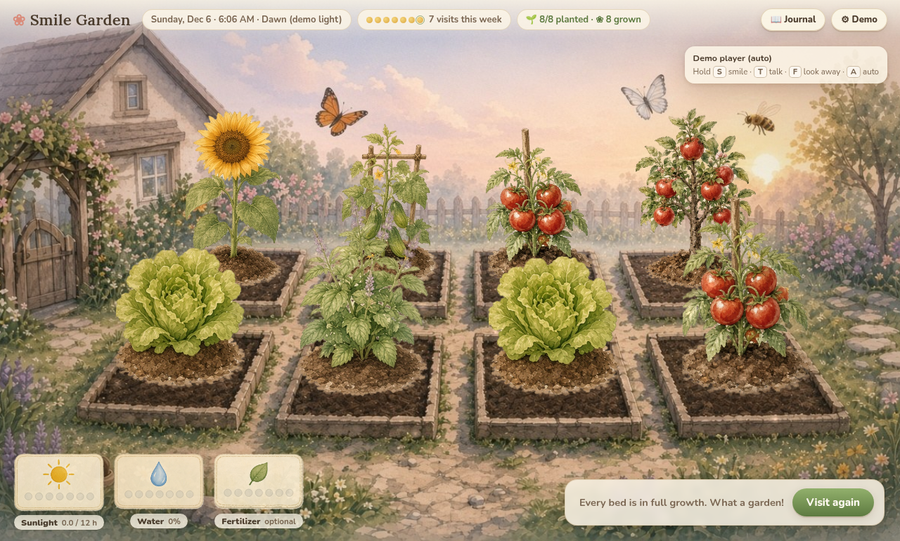
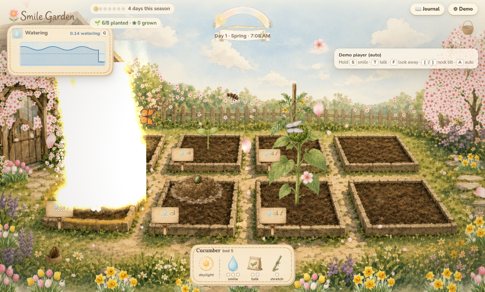
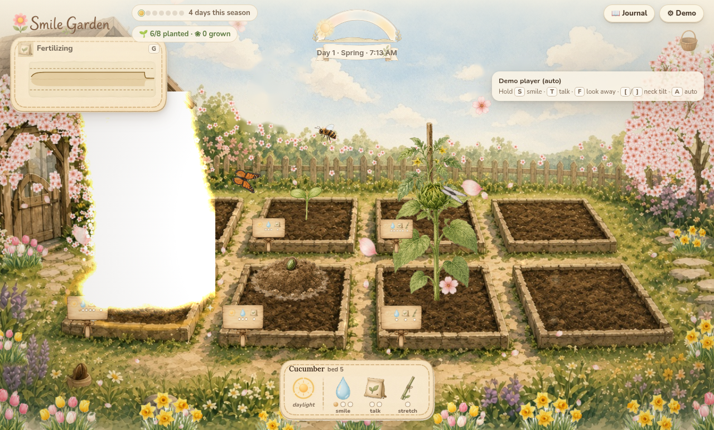
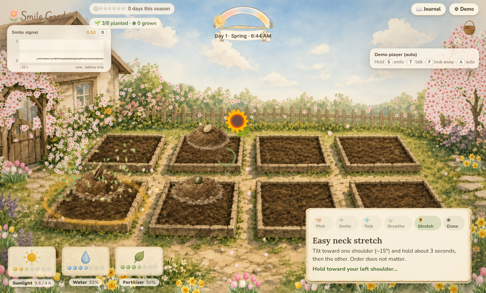

# Smile Garden 🌻 (v0.3: daily-visit prototype)

A calm, painterly garden you visit for a few minutes a day. **Smile** to water your
beds, **talk** to fertilize them, and (for taller plants) **stretch** to stake them.
**Sunlight** fills on its own while the garden clock is in daylight. Plants grow over
real days when their daily needs are met. Nothing ever dies or wilts. Built on Presage
**SmartSpectra**'s Node/Electron SDK (face expression + talking metrics + landmarks for
stretch), with a keyboard/demo fallback so it runs without a camera or API key.

| Dawn | Midday | Night |
|---|---|---|
|  |  |  |

| Smile (water) | Talk (fertilizer) | Stretch (stake) | Summary |
|---|---|---|---|
|  |  |  |  |

## The daily visit

1. **Wellness notice (once).** Wellness only, not a medical device. 18+ only (checkbox).
2. **Greeting / idle garden.** Local-time greeting, garden status, weekly visit count.
   Plant seeds here (or click any empty bed). The day clock runs while the app is open;
   daylight fills each plant's **sun** dots automatically.
3. **Tend a bed.** Click a planted bed that still needs care. Per-plant need dots
   (`game/care-needs.js`, ~10 s smile per water dot, ~15 s talk per fertilizer dot):
   * **Smile → water.** HAPPY expression (0–1, smoothed, on at 0.50 / off at 0.42) fills
     water dots. Drops fall and ripple on the soil while you smile.
   * **Talk → fertilizer.** `face.talking` fills fertilizer dots. Gentle prompts rotate
     while you chat with the plant.
   * **Stretch → stake** (cucumber, tomato, sunflower, apple). A short left/right neck
     stretch completes the stake need until harvest.
   * **Harvest** when mature (click the crop; smile briefly to confirm, or Enter/Space).
4. **Summary / bedtime.** Care totals for the day; beds that grew bloom with a floating
   label; plants still waiting say why, kindly.

When the face is missing, care **waits** and a hint appears ("Where did you go?").
If the camera reports the scene is too dark (or backlit), the hint asks for more light —
at garden night: "🌙 It's a little dark in here: try turning on a soft light in front of you".

### Care mapping (`game/care-needs.js`)

| Need | How it fills | Typical time |
|---|---|---|
| Sun | Automatic in daylight (garden clock) | ~10 s per dot |
| Water | Smile (HAPPY) | ~10 s per dot |
| Fertilizer | Talk (`face.talking`) | ~15 s per dot |
| Stake | Neck stretch (landmarks) | one completed stretch |

### Plant needs (`game/logic.js`)

| Plant | Sun | Water | Fertilizer | Stake | Unlocks |
|---|---|---|---|---|---|
| Lettuce | 1 | 3 | 1 | — | start |
| Mint | 1 | 3 | 1 | — | start |
| Cucumber | 2 | 3 | 2 | yes | start |
| Tomato | 3 | 2 | 3 | yes | after 2 visits |
| Sunflower | 3 | 1 | 1 | yes | after 3 visits |
| Apple tree | 3 | 2 | 2 | yes | after 4 visits |

* Each plant grows **one stage** (seed → sprout → young → growing → mature) when its
  daily needs are met and the garden day advances (growth is deferred until bedtime /
  the next day — see `docs/DAY-CLOCK.md`).
* Without enough care a plant just **waits**. Nothing wilts.
* **Weekly visit count** (Mon–Sun dots in the top bar), never streaks. Missing a day costs nothing.
* Seed library blurbs still cite real sun-hour ranges from university extension sources.

### Garden journal (J)

* **Diary:** plantings, stage changes, maturity, new seeds and each day's care, by day.
* **My plants:** each bed's stage, age, and need progress.
* **Seed library:** each plant's care summary, sun-hour source, and planting tips.

### Lighting

The scene follows local / garden time: **dawn 5–9, midday 9–19, night otherwise**, with a
1.6 s crossfade between painted backdrops. The plant sprites get a matching colour grade (dimmer and
cooler at night). The demo tools have a lighting override.

### Art and motion

Painted assets from the art set live in `assets/` (backdrops as JPEG, plants as transparent PNG). Code-driven
motion is drawn on top in `renderer/scene.js`: gentle sway (a shear anchored at the soil line), drifting light
motes by day, **fireflies at night** (code-drawn), water drops while smiling, fertilizer flecks while
talking, a crossfade + soft bloom glow + sparkles between stages, a planting puff, and a glowing
highlight on the target bed.

Art fixes done in code or scripts:
* `scripts/defringe-sprites.py` removes the pale paper **soil halo** around the plant sprites, fills the
  see-through holes in the tomato/apple highlights, and tones the dusty soil rim.
* `scripts/cutout-cards.py` cuts the meter cards out of their paper backdrop; the painted dot row was
  inpainted away so the meter dots are drawn live (`renderer/art.js` has the dot positions).
* The **night backdrop still has the daytime bee and butterflies painted in**. Fireflies are added in code;
  repainting the backdrop is left for the next art pass.

## Run

```bash
npm install
npm start                 # SmartSpectra mode (builds the bundles first; needs SMARTSPECTRA_API_KEY)
npm run pack              # unpackaged electron-builder output under release/ (host platform)
npm run dist              # installers / archives under release/ (host platform)
npm test                  # node:test: game logic, daily visit, persistence, time of day, care needs, art manifest
npm run check             # node --check on every first-party .js file
xvfb-run -a npm run screenshots   # regenerate docs/*.png (headless Linux; plain `npm run screenshots` with a display)
```

**Keys:** `J` journal · `D` demo tools · `N` next day (with demo tools open) ·
`Esc` closes panels (journal, picker, demo tools, camera check). In keyboard mode: hold `S` to smile (water),
`T` to talk (fertilize), `[` / `]` to stretch (stake), `F` to look away, `Enter` to pick (and `Space` also confirms
harvest when a crop is ready — otherwise it smiles like `S`).

**No key or camera?** A banner offers **Play with keyboard instead**, which swaps in the keyboard player.
During a visit (or warm-up), a **Switch to Keyboard mode** / **Switch to Camera mode** button under the PiP
toggles the same modes; Demo tools has the same switch.

**Demo tools (⚙︎ Demo):** ⏭ Next day (moves the game clock one day; real growth rules still apply),
lighting override, keyboard ↔ camera input toggle, simulate 5 good days, fill empty beds, reset garden.

**Saved state:** `localStorage` key `smile-garden.v3` (versioned JSON: beds, visit days, journal,
settings, demo day offset). The screenshot run uses a throwaway profile and never touches your garden.

| Variable | Effect |
|---|---|
| `SMARTSPECTRA_API_KEY` | Your API key. From `.env` or the environment |
| `SMARTSPECTRA_TELEMETRY=0` | Opt out of SDK telemetry |
| `SMARTSPECTRA_DIAGNOSTICS=1` | Opens DevTools |

### API key

Register for a free key at <https://physiology.presagetech.com/auth/register>. Your key must be
enabled for **face** metrics. Then either:

```bash
cp .env.example .env
# edit .env and set SMARTSPECTRA_API_KEY=...
npm start
```

or export `SMARTSPECTRA_API_KEY` in your shell. Values already set in the environment override `.env`.

## How it works

* `main.js`: the Electron main process owns the native SmartSpectra pipeline (`bindSmartSpectraIpc`), grants
  camera-only permission to our own `renderer/index.html`, and hands config to the renderer. The API key is
  delivered once via `takeApiKey` (not kept on the config object). `contextIsolation` and `sandbox` are on;
  real mode fails closed if `dist/preload-sdk.bundle.js` is missing.
* `renderer/sdk-source.js`: the SDK adapter (bundled by esbuild), emitting `expression` (HAPPY 0–1), `talking`,
  `landmarks`, `breathing` (rate; still requested by the SDK adapter but **not** used for garden care), and
  `validation` events. `renderer/mock-source.js` emits the same events from a simulated or keyboard player.
* `game/logic.js`: the plant table (need dots + extension sun-hour sources), smile smoothing and hysteresis, `SmileTrace`.
* `game/care-needs.js`: per-plant daily need dots, auto-care channel pick (talk > smile; stretch for stake).
* `game/visit.js`: the daily loop (pure, unit-tested): time of day, day/week keys, `GameClock` (with a demo
  offset), state load/save/sanitize, planting, `applyVisit`, `VisitSession`.
* `renderer/scene.js` (canvas painting + motion), `renderer/app.js` (screens, HUD, input, persistence),
  `renderer/smile-chart.js` (live 10 s smile chart with thresholds, no-face gaps and a talking strip).

### SDK calls used

| Call | Where | Source |
|---|---|---|
| `bindSmartSpectraIpc(win)` from `@smartspectra/node-sdk/main` | main.js | docs/nodejs.md, "Electron integration"; electron-quickstart `main.js` |
| `SMARTSPECTRA_CAPI_PATH` for packaged builds | main.js | electron-quickstart `main.js` |
| `require('@smartspectra/node-sdk/preload')` | preload-sdk.js | docs/nodejs.md, "Electron integration" |
| `new SmartSpectraSDK({ apiKey, requestedMetrics: [...faceMetrics, ...breathingMetrics], enableAccumulatedOutput: false, enableTelemetry })` | sdk-source.js | docs/nodejs/metrics.md, "Metric Bundles" + "Advanced" (face + optional breathing rate; optional cardio) |
| `sdk.on('metrics', (buf, timestampUs))` + `decodeMetrics(buf)` from `@smartspectra/node-sdk/messages` | sdk-source.js | docs/nodejs/metrics.md, "Read Metrics"; electron-quickstart `renderer.js` |
| `face.expression[] → { stable, scores: [{ type, confidence 0–100 }] }`, `ExpressionType.HAPPY = 5` | sdk-source.js, logic.js | docs/nodejs/metrics.md "Advanced"; docs/data-types.md#expression, #expressionscore |
| `face.talking[] → DetectionStatus { detected, stable }` | sdk-source.js | docs/nodejs/metrics.md ("`metrics.face?.talking?.at(-1)?.detected`"); docs/data-types.md#face |
| `face.landmarks[] → { value: Point2dFloat[], stable }` (stretch / stake) | sdk-source.js | docs/nodejs/metrics.md "Advanced"; docs/data-types.md#landmarks |
| `breathing.rate[] → MeasurementWithConfidence` (decoded; **not** used for care scoring) | sdk-source.js | docs/nodejs/metrics.md "Breathing and Pulse"; docs/data-types.md#breathing |
| `sdk.on('validationStatus', (code, ts, hint))` + `ValidationCode` | sdk-source.js | docs/nodejs.md; API reference |
| `sdk.on('processingStatus')`, `sdk.on('error', (code, message, retryable))`, `SmartSpectraErrorCode` | sdk-source.js | docs/nodejs.md; API reference |
| `sdk.on('streamAvailable', stream)`, `start()`, `stop()`, `reset()`, `destroy()`, `SmartSpectraSDK.version` | sdk-source.js | docs/nodejs.md; renderer `index.d.ts` |

## Camera permission

* **macOS:** allow the camera in System Settings → Privacy & Security → Camera. When you run
  from a terminal, the prompt may name your terminal app. Packaged builds set
  `NSCameraUsageDescription` and the camera entitlement (`build/entitlements.mac.plist`).
* **Windows:** Settings → Privacy & security → Camera → allow desktop apps.
* **Linux:** your user needs access to `/dev/video*` (usually through the `video` group).
* Close other apps that are using the webcam first.

## Packaging

```bash
npm run pack   # release/<platform>-unpacked/ for local smoke-testing
npm run dist   # platform installer/archive under release/
```

`electron-builder.config.js` copies the host `@smartspectra/node-sdk-<platform>-<arch>` closure into
`resources/smartspectra/`. `main.js` points `SMARTSPECTRA_CAPI_PATH` there when `app.isPackaged`.
Code signing and notarization are not configured yet — add your Apple/Windows credentials before shipping.

## Privacy and telemetry

* Video frames are processed **on the device**. The SDK contacts Presage only to authenticate
  the API key and validate the subscription.
* SDK **telemetry is on by default** (`enableTelemetry` defaults to `true`). It sends aggregate
  session summaries, such as the SDK version, platform and device model, frame-rate and
  performance counts, validation-state counts, and coarse error codes. It does **not** send raw
  video or measured physiological values. Tell your players about this, or opt out with
  `SMARTSPECTRA_TELEMETRY=0`. Details: <https://smartspectra.presagetech.com/docs/telemetry-and-privacy>

## Terms: wellness only, adults only

* SmartSpectra metrics are for **general wellness and informational purposes only**. They are not
  FDA-cleared and may not be used for diagnosis or treatment. The game makes no health claims: smiling,
  chatting, and a short stretch are framed as garden care only.
* Presage's terms do **not** allow use with people **under 18**. Check the current terms before you ship.

## Project layout

```
main.js                    Electron main: window, permissions, config/API-key IPC, bindSmartSpectraIpc
preload.js / preload-sdk.js   contextBridge API (+ SDK preload bundle entry)
electron-builder.config.js Packaged app + SmartSpectra native extraResources
build/entitlements.mac.plist  macOS camera + hardened-runtime entitlements
game/logic.js              plants (need dots + sun-hour sources), smile detection, SmileTrace (UMD)
game/care-needs.js         daily need dots, auto-care channel routing
game/visit.js              daily visit loop, persistence, time of day (UMD)
renderer/index.html        screens + HUD (strict CSP)
renderer/app.js            flow, HUD, picker, summary, journal, keyboard (orchestration)
renderer/camera-check-controller.js  camera warm-up flow (with camera-check-ui.js)
renderer/dev-hooks.js      capture/probe automation (`window.__smileGarden`)
renderer/scene.js          painted garden + code-driven motion (canvas)
renderer/art.js            art manifest: backdrops, plot geometry, sprite baselines, meter dots
renderer/smile-chart.js    live smile chart
renderer/sdk-source.js     SmartSpectra renderer adapter (bundled to dist/)
renderer/mock-source.js    simulated / keyboard player
renderer/styles.css
assets/                    backdrops, plant sprites, UI cards, fonts (Lora, Nunito: SIL Open Font License)
test/                      logic, visit and asset tests (node:test)
scripts/                   screenshot capture, syntax check, sprite defringe + card cutout tools
docs/                      screenshots
```

## Known gaps (prototype)

* The **night backdrop** still shows the painted bee and butterflies (fireflies are added on top).
* Some UI / step-copy leftovers still mention a legacy breathe step; garden care no longer uses breathing
  for fertilizer (talk fills fertilizer; breathe metrics are unused for scoring).
* Thresholds (smile 0.50/0.42, ~10 s / water dot, ~15 s / fertilizer dot) are starting guesses; tune
  them on real cameras.
* The SDK `TODO(sdk)` questions from v0.2 still apply for key authorization and the meaning of
  `Expression.stable`.
* The renderer SDK still needs the API key in-process once (via `takeApiKey`); treat keys as rotatable.
* No reminder notifications yet; seasons / day clock are evolving (`docs/DAY-CLOCK.md`).
* The v0.2 calm check (pulse/HRV) and flower crown were removed in favour of the daily loop
  (they are in git history and `/workspace/smile-garden-backup-v0.2`).
* Phone layout isn't done: this is a 1280×800 desktop Electron prototype.
* Packaged builds are unsigned; add notarization / Windows signing before public distribution.
