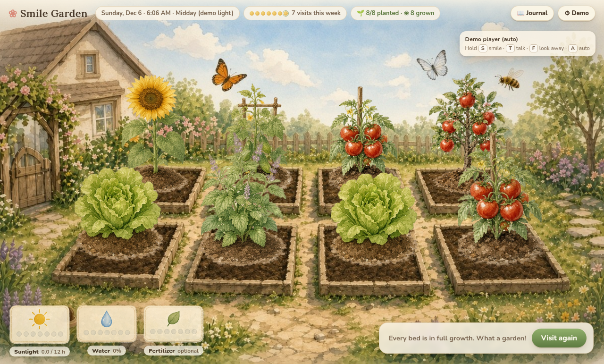
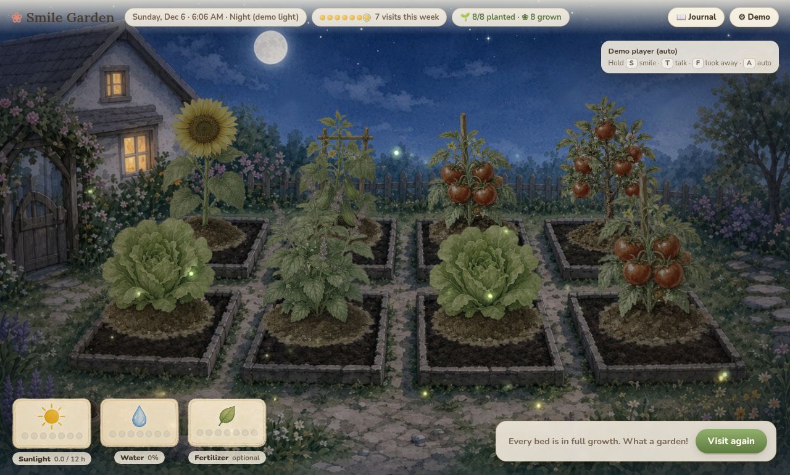
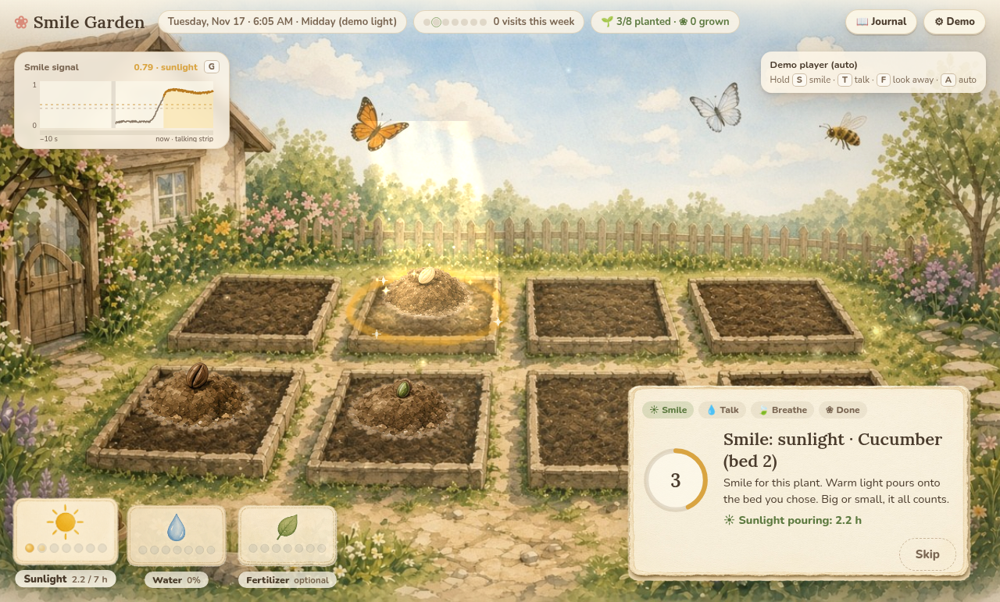
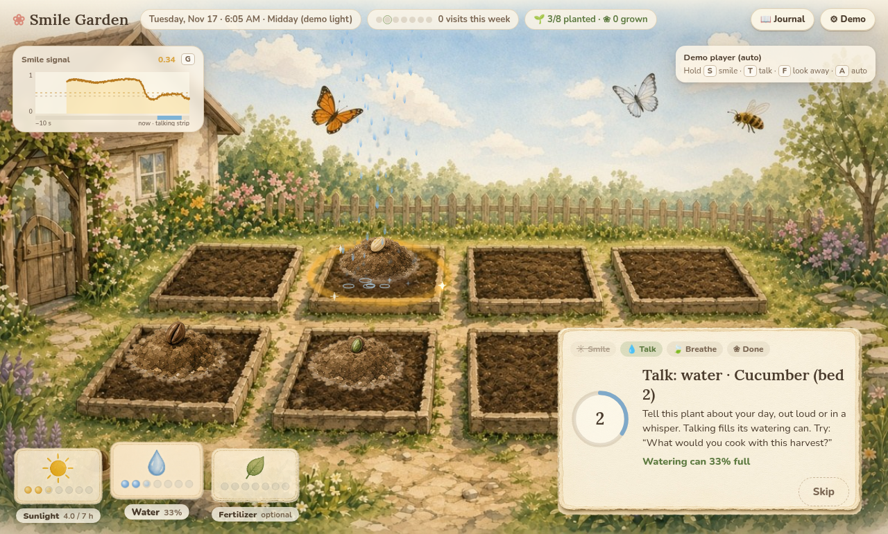
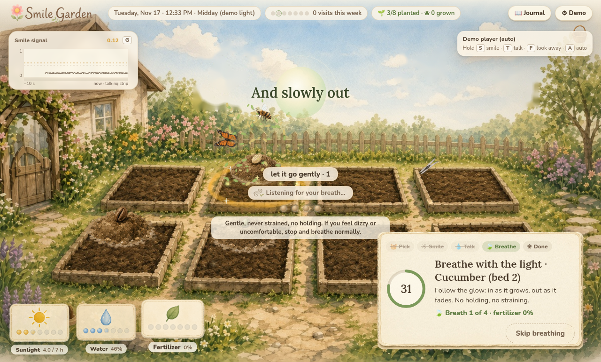
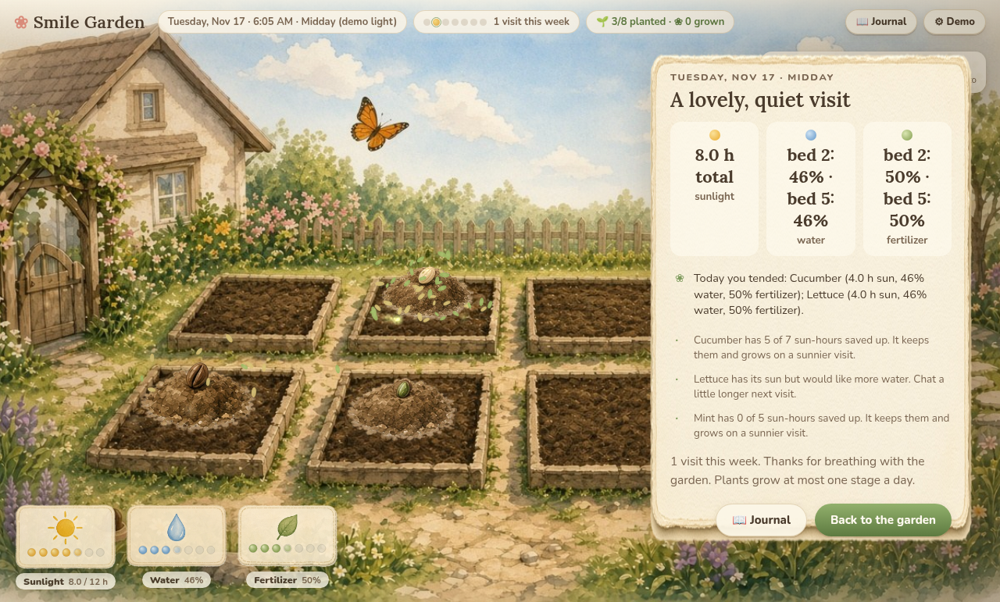

# Smile Garden 🌻 (v0.3: daily-visit prototype)

A calm, painterly garden you visit for **2–3 minutes a day**. Smiling pours sunlight on your beds,
talking to your plants fills the watering can, and a few optional calm breaths add fertilizer.
Plants grow one stage per day (over real days) when they have had enough sun and water. Nothing
ever dies or wilts. Built on Presage **SmartSpectra**'s Node/Electron SDK (face expression +
talking metrics), with a keyboard/demo fallback so it runs without a camera or API key.

| Dawn | Midday | Night |
|---|---|---|
|  |  |  |

| Smile (sunlight) | Talk (water) | Breathe (fertilizer, optional) | Summary |
|---|---|---|---|
|  |  |  |  |

## The daily visit

1. **Wellness notice (once).** Wellness only, not a medical device. Breathing is optional; people with
   heart or lung conditions, or who are pregnant, should check with a doctor first or skip it. 18+ only
   (checkbox).
2. **Greeting.** Based on the local time ("Good morning, gardener"), garden status, the plan for today,
   and a weekly visit count. You can plant seeds here (or click any empty bed).
3. **Smile ~45 s → sunlight.** The SDK's HAPPY expression score (0–1, smoothed, on at 0.50 and off at 0.42)
   fills the sun meter. About 30 s of real smiling gives the maximum 12 sun-hours for the day; bigger
   smiles count a bit more. Sun shafts brighten and motes drift while you smile.
4. **Talk ~30 s → water.** `face.talking` detected fills the watering can (about 12 s of chatting fills
   it). Gentle prompts rotate ("What made you smile today?"). Drops fall and ripple on the soil.
5. **Breathe (optional) → fertilizer.** Soft nose breathing guided by a glowing orb, with **no holds**:
   * default **4 s in / 6 s out** (6 breaths a minute), or the **gentler 3 s in / 5 s out**;
   * **3–6 breaths** per bout (default 4, **40 s**); fertilizer = finished breaths ÷ planned;
   * SmartSpectra **breathing rate** is shown as feedback when available (display only; not used for scoring);
   painted pills / seed dots: `assets/breath-manifest.json`, `renderer/breath-ui.css`, reference mockup `docs/breath-mockup.png`, capture frames `docs/07a-breath-rate-*.png`;
   * **Skip** is always visible, and the note says to stop and breathe normally if you feel dizzy.
   Fertilizer only speeds growth (+50 % banked sunlight at 100 %). It is never required.
6. **Summary.** Sun-hours, water and fertilizer; each bed that grew blooms in turn with a floating label;
   plants that are still waiting say why, kindly ("Sunflower has 7 of 10 sun-hours saved up").

When the face is missing, the step timer **waits** and a hint appears ("Where did you go?").
If the camera reports the scene is too dark (or backlit), the hint asks for more light —
at garden night: "🌙 It's a little dark in here: try turning on a soft light in front of you".

### Growing rules (`game/visit.js`)

| Plant | Real sun need (source in the journal) | Sun-hours per stage | Unlocks |
|---|---|---|---|
| Lettuce | ~4 h | 4 | start |
| Mint | 4–6 h | 5 | start |
| Cucumber | 6–8 h | 7 | start |
| Tomato | 7–8 h | 8 | after 2 visits |
| Sunflower | 6–8+ h | 10 | after 3 visits |
| Apple tree | 8 h | 12 | after 4 visits |

* Each plant banks the day's sunlight (capped at its cost) and grows **one stage** (seed → sprout → young →
  growing → mature) when its bank is full **and** the watering can is at least half full.
* **At most one stage per local day.** Days reset at local midnight. A sun-hungry apple tree on 6-hour days
  grows every other day; lettuce grows every day.
* Without enough water or sun a plant just **waits and keeps its banked sunlight**. Nothing wilts.
* **Weekly visit count** (Mon–Sun dots in the top bar), never streaks. Missing a day costs nothing.
* Score = beds planted / 8 and plants grown to maturity.

### Garden journal (J)

* **Diary:** plantings, stage changes, maturity, new seeds and each visit's sun/water/fertilizer, by day.
* **My plants:** each bed's stage, age, sun need and sunlight saved toward the next stage.
* **Seed library:** each plant's sun need with its university-extension **source**, the in-game cost, and
  three general planting tips.

### Lighting

The scene follows local time: **dawn 5–9, midday 9–19, night otherwise**, with a
1.6 s crossfade between painted backdrops. The plant sprites get a matching colour grade (dimmer and
cooler at night). The demo tools have a lighting override.

### Art and motion

Painted assets from the art set live in `assets/` (backdrops as JPEG, plants as transparent PNG). Code-driven
motion is drawn on top in `renderer/scene.js`: gentle sway (a shear anchored at the soil line), drifting light
motes by day, **fireflies at night** (code-drawn), sun shafts while smiling, water drops and ripples while
talking, fertilizer flecks while breathing, a crossfade + soft bloom glow + sparkles between stages, a
planting puff, and a glowing highlight on the target bed.

Art fixes done in code or scripts:
* `scripts/defringe-sprites.py` removes the pale paper **soil halo** around the plant sprites, fills the
  see-through holes in the tomato/apple highlights, and tones the dusty soil rim.
* `scripts/cutout-cards.py` cuts the meter cards out of their paper backdrop; the painted dot row was
  inpainted away so the meter dots are drawn live (`renderer/art.js` has the dot positions).
* The **night backdrop still has the daytime bee and butterflies painted in**. Fireflies are added in code;
  repainting the backdrop is left for the next art pass.

## Run

```bash
npm install
npm run start:mock        # demo mode: simulated player, no SDK / key / camera (45 s smile, 30 s talk)
npm run start:mock:fast   # demo mode with short 14 s / 10 s steps (breathing keeps its real pace)
npm start                 # real SmartSpectra mode (builds the bundles first; needs SMARTSPECTRA_API_KEY)
npm run pack              # unpackaged electron-builder output under release/ (host platform)
npm run dist              # installers / archives under release/ (host platform)
npm test                  # node:test: game logic, daily visit, persistence, time of day, breathing, art manifest
npm run check             # node --check on every first-party .js file
xvfb-run -a npm run screenshots   # regenerate docs/*.png (headless Linux; plain `npm run screenshots` with a display)
```

**Keys:** `G` smile chart (during visits) · `J` journal · `D` demo tools · `N` next day (with demo tools open) ·
`Esc` closes panels (journal, picker, demo tools, camera check). In demo/keyboard mode: hold `S` to smile (water),
`T` to talk (fertilize), `[` / `]` to stretch (stake), `F` to look away, `Enter` to pick (and `Space` also confirms
harvest when a crop is ready — otherwise it smiles like `S`), `A` back to the simulated player.

**No key or camera?** Real mode shows a banner with **Play with keyboard instead**, which swaps in the
keyboard player.

**Demo tools (⚙︎ Demo):** ⏭ Next day (moves the game clock one day; real growth rules still apply),
lighting override, simulate 5 good days, fill empty beds, reset garden.

**Saved state:** `localStorage` key `smile-garden.v3` (versioned JSON: beds, visit days, journal,
settings, demo day offset). The screenshot run uses a throwaway profile and never touches your garden.

| Variable | Effect |
|---|---|
| `SMARTSPECTRA_API_KEY` | Your API key (real mode). From `.env` or the environment |
| `SMILE_GARDEN_MOCK=1` | Demo mode (same as `--mock`) |
| `SMILE_GARDEN_FAST=1` | Demo mode only: short smile/talk steps (same as `--fast`) |
| `SMARTSPECTRA_TELEMETRY=0` | Opt out of SDK telemetry |
| `SMARTSPECTRA_DIAGNOSTICS=1` | Opens DevTools |

### API key

Register for a free key at <https://physiology.presagetech.com/auth/register>. Your key must be
enabled for **face** metrics. Then either:

```bash
cp .env.example .env
# edit .env and set SMARTSPECTRA_API_KEY=...
npm start
```

or export `SMARTSPECTRA_API_KEY` in your shell. Values already set in the environment override `.env`.

## How it works

* `main.js`: the Electron main process owns the native SmartSpectra pipeline (`bindSmartSpectraIpc`), grants
  camera-only permission to our own `renderer/index.html`, and hands config to the renderer. The API key is
  delivered once via `takeApiKey` (not kept on the config object). `contextIsolation` and `sandbox` are on;
  real mode fails closed if `dist/preload-sdk.bundle.js` is missing.
* `renderer/sdk-source.js`: the SDK adapter (bundled by esbuild), emitting `expression` (HAPPY 0–1), `talking`,
  `breathing` (rate) and `validation` events. `renderer/mock-source.js` emits the same events from a simulated or keyboard player.
* `game/logic.js`: the plant table with real sun hours and sources, smile smoothing and hysteresis, `SmileTrace`.
* `game/visit.js`: the daily loop (pure, unit-tested): time of day, day/week keys, `GameClock` (with a demo
  offset), state load/save/sanitize, planting, `applyVisit`, `BreathPacer`, `VisitSession`.
* `renderer/scene.js` (canvas painting + motion), `renderer/app.js` (screens, HUD, input, persistence),
  `renderer/smile-chart.js` (live 10 s smile chart with thresholds, no-face gaps and a talking strip).

### SDK calls used

| Call | Where | Source |
|---|---|---|
| `bindSmartSpectraIpc(win)` from `@smartspectra/node-sdk/main` | main.js | docs/nodejs.md, "Electron integration"; electron-quickstart `main.js` |
| `SMARTSPECTRA_CAPI_PATH` for packaged builds | main.js | electron-quickstart `main.js` |
| `require('@smartspectra/node-sdk/preload')` | preload-sdk.js | docs/nodejs.md, "Electron integration" |
| `new SmartSpectraSDK({ apiKey, requestedMetrics: [...faceMetrics, ...breathingMetrics], enableAccumulatedOutput: false, enableTelemetry })` | sdk-source.js | docs/nodejs/metrics.md, "Metric Bundles" + "Advanced" (face + breathing rate / chest / abdomen; optional cardio) |
| `sdk.on('metrics', (buf, timestampUs))` + `decodeMetrics(buf)` from `@smartspectra/node-sdk/messages` | sdk-source.js | docs/nodejs/metrics.md, "Read Metrics"; electron-quickstart `renderer.js` |
| `face.expression[] → { stable, scores: [{ type, confidence 0–100 }] }`, `ExpressionType.HAPPY = 5` | sdk-source.js, logic.js | docs/nodejs/metrics.md "Advanced"; docs/data-types.md#expression, #expressionscore |
| `face.talking[] → DetectionStatus { detected, stable }` | sdk-source.js | docs/nodejs/metrics.md ("`metrics.face?.talking?.at(-1)?.detected`"); docs/data-types.md#face |
| `breathing.rate[] → MeasurementWithConfidence` (display-only during breathe) | sdk-source.js | docs/nodejs/metrics.md "Breathing and Pulse"; docs/data-types.md#breathing |
| `face.landmarks[] → { value: Point2dFloat[], stable }` (decoded, not drawn in v3) | sdk-source.js | docs/nodejs/metrics.md "Advanced"; docs/data-types.md#landmarks |
| `sdk.on('validationStatus', (code, ts, hint))` + `ValidationCode` | sdk-source.js | docs/nodejs.md; API reference |
| `sdk.on('processingStatus')`, `sdk.on('error', (code, message, retryable))`, `SmartSpectraErrorCode` | sdk-source.js | docs/nodejs.md; API reference |
| `sdk.on('streamAvailable', stream)`, `start()`, `stop()`, `reset()`, `destroy()`, `SmartSpectraSDK.version` | sdk-source.js | docs/nodejs.md; renderer `index.d.ts` |

## Camera permission

* **macOS:** allow the camera in System Settings → Privacy & Security → Camera. When you run
  from a terminal, the prompt may name your terminal app. Packaged builds set
  `NSCameraUsageDescription` and the camera entitlement (`build/entitlements.mac.plist`).
* **Windows:** Settings → Privacy & security → Camera → allow desktop apps.
* **Linux:** your user needs access to `/dev/video*` (usually through the `video` group).
* Close other apps that are using the webcam first.

## Packaging

```bash
npm run pack   # release/<platform>-unpacked/ for local smoke-testing
npm run dist   # platform installer/archive under release/
```

`electron-builder.config.js` copies the host `@smartspectra/node-sdk-<platform>-<arch>` closure into
`resources/smartspectra/`. `main.js` points `SMARTSPECTRA_CAPI_PATH` there when `app.isPackaged`.
Code signing and notarization are not configured yet — add your Apple/Windows credentials before shipping.

## Privacy and telemetry

* Video frames are processed **on the device**. The SDK contacts Presage only to authenticate
  the API key and validate the subscription.
* SDK **telemetry is on by default** (`enableTelemetry` defaults to `true`). It sends aggregate
  session summaries, such as the SDK version, platform and device model, frame-rate and
  performance counts, validation-state counts, and coarse error codes. It does **not** send raw
  video or measured physiological values. Tell your players about this, or opt out with
  `SMARTSPECTRA_TELEMETRY=0`. Details: <https://smartspectra.presagetech.com/docs/telemetry-and-privacy>

## Terms: wellness only, adults only

* SmartSpectra metrics are for **general wellness and informational purposes only**. They are not
  FDA-cleared and may not be used for diagnosis or treatment. The game makes no health claims: smiling,
  chatting and breathing are framed as garden care, and the breathing guide is optional and time-based
  (it does not measure you).
* The breathing guidance (soft nose breathing, longer out-breath, no holds, short bouts, skip any time,
  stop if dizzy, check with a doctor if you have heart or lung conditions or are pregnant) is design research,
  not clinical advice. Have a clinician and a regulatory reviewer check the copy before shipping.
* Presage's terms do **not** allow use with people **under 18**. Check the current terms before you ship.

## Project layout

```
main.js                    Electron main: window, permissions, config/API-key IPC, bindSmartSpectraIpc
preload.js / preload-sdk.js   contextBridge API (+ SDK preload bundle entry)
electron-builder.config.js Packaged app + SmartSpectra native extraResources
build/entitlements.mac.plist  macOS camera + hardened-runtime entitlements
game/logic.js              plants (real sun hours + sources), smile detection, SmileTrace (UMD)
game/visit.js              daily visit loop, persistence, time of day, breathing pacer (UMD)
renderer/index.html        screens + HUD (strict CSP)
renderer/app.js            flow, HUD, picker, summary, journal, keyboard (orchestration)
renderer/camera-check-controller.js  camera warm-up flow (with camera-check-ui.js)
renderer/dev-hooks.js      mock/capture automation (`window.__smileGarden`)
renderer/scene.js          painted garden + code-driven motion (canvas)
renderer/art.js            art manifest: backdrops, plot geometry, sprite baselines, meter dots
renderer/smile-chart.js    live smile chart (G)
renderer/sdk-source.js     SmartSpectra renderer adapter (bundled to dist/)
renderer/mock-source.js    simulated / keyboard player
renderer/styles.css
assets/                    backdrops, plant sprites, UI cards, fonts (Lora, Nunito: SIL Open Font License)
test/                      logic, visit and asset tests (node:test)
scripts/                   screenshot capture, syntax check, sprite defringe + card cutout tools
docs/                      screenshots
```

## Known gaps (prototype)

* The **night backdrop** still shows the painted bee and butterflies (fireflies are added on top).
* Breathing **fertilizer** is still guided (finished breaths ÷ planned). SmartSpectra breathing rate is
  requested for the whole visit so it can warm up during smile/talk, then shown during the breathe step.
* Thresholds (smile 0.50/0.42, 30 s of smiling = 12 h, 12 s of talking = full can) are starting guesses; tune
  them on real cameras.
* The SDK `TODO(sdk)` questions from v0.2 still apply for key authorization and the meaning of
  `Expression.stable`.
* The renderer SDK still needs the API key in-process once (via `takeApiKey`); treat keys as rotatable.
* No reminder notifications yet, and no seasons; the "Visit again" path lets you visit more than once a day,
  but plants still grow at most once.
* The v0.2 calm check (pulse/HRV) and flower crown were removed in favour of the daily loop
  (they are in git history and `/workspace/smile-garden-backup-v0.2`).
* Phone layout isn't done: this is a 1280×800 desktop Electron prototype.
* Packaged builds are unsigned; add notarization / Windows signing before public distribution.
