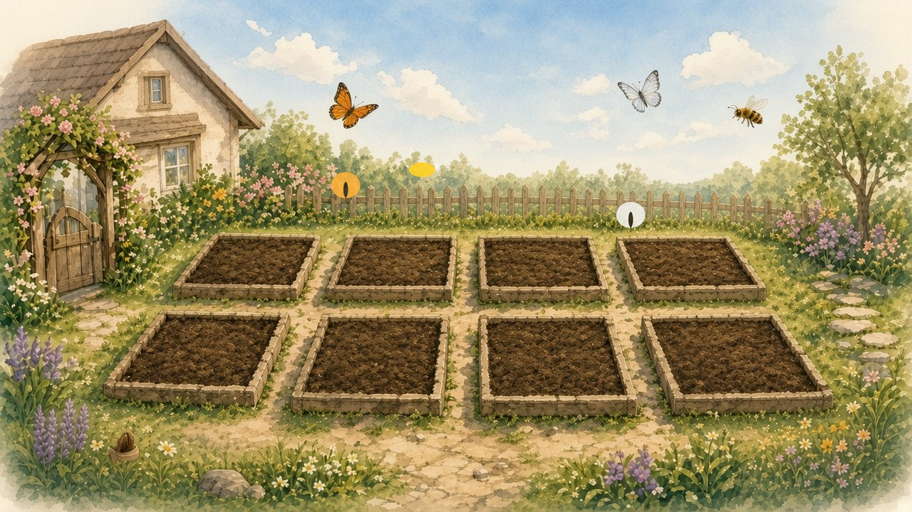

# Daytime garden critters

Animated **monarch butterfly**, **white butterfly**, and **bee** fly over the garden during **dawn**, **midday**, and **golden hour**. They are hidden at **night**, fading out with the same backdrop crossfade as plants.

## Assets (`assets/critters/`)

| Strip | Frames | Size/frame | FPS |
|-------|--------|------------|-----|
| `butterfly-monarch-strip.png` | 8 | 128×112 | 12 |
| `butterfly-white-strip.png` | 8 | 128×112 | 12 |
| `bee-strip.png` | 4 | 112×96 | 16 |

`manifest.json` is the source of truth; `renderer/art.js` mirrors it for the canvas. Frame count = strip width ÷ frame width.

Day backdrops (`assets/backgrounds/dawn.png`, `midday.png`, `golden-hour.png`) are insect-free PNGs; `night.jpg` is unchanged.

Apply Heily’s handoff zip with:

```bash
./scripts/apply-critters-handoff.sh /path/to/critters-handoff.zip
```

## Rendering

- Drawn after plants, before tend-effect strips (under the HTML UI).
- Butterflies rotate toward travel direction (art faces up).
- Bee flips horizontally when moving right (art faces left).
- `prefers-reduced-motion: reduce`: frame 0, slower wander.



## Logo (follow-up)

`renderer/index.html` reserves `#brand-logo` → `assets/ui/logo.png` (Heily option A). The ❀ mark stays until the logo loads.