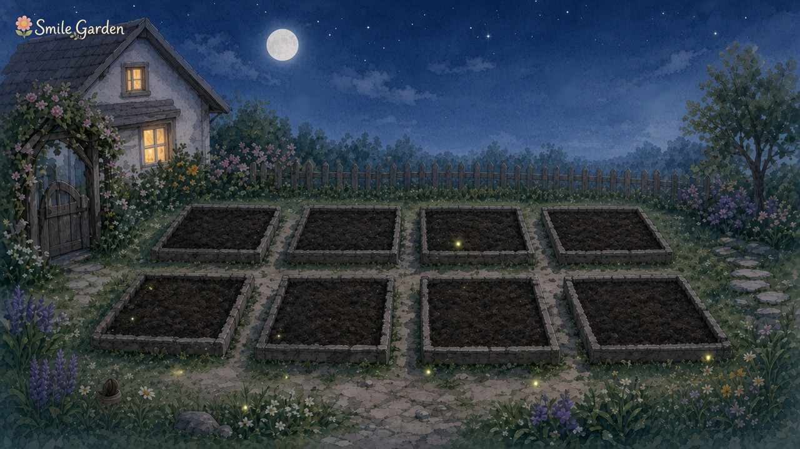

# Daytime garden critters & canvas logo

Animated **monarch butterfly**, **white butterfly**, and **bee** on **dawn / midday**, fading at **night** with the backdrop crossfade.

## Critter strips (`assets/critters/`)

| Strip | Frames | Frame size | On-screen scale | FPS |
|-------|--------|------------|-----------------|-----|
| `butterfly-monarch-strip.png` | 8 (1600×200) | 200×200 | **0.32** (~64px) | 12 |
| `butterfly-white-strip.png` | 8 | 200×200 | **0.32** | 12 |
| `bee-strip.png` | 4 (800×200) | 200×200 | **0.28** (~56px) | 16 |

Frame count = strip width ÷ 200. Creatures are centered in each frame; butterflies face **up** (rotate to velocity); bee faces **left** (flip when moving right).

`manifest.json` lists `frames`, `size`, `fps`, `anchor`. Config scales live in `renderer/art.js` → `critters.strips[*].scale`.

Handoff zip: `./scripts/apply-critters-handoff.sh /path/to/critters-logo-handoff.zip`

## Logo option A (`assets/ui/`)

| File | Use |
|------|-----|
| `logo-day.png` | Brown ink (368×98 @2x → **184×49** backdrop px) |
| `logo-night.png` | Cream ink + soft halo |

Drawn on the **canvas** at `ART.logoHud` (top-left). Day/night layers crossfade with scene lighting; HTML **Smile Garden** text is the fallback until images load (`data-canvas-logo` on `<body>`).

## Day backdrops

`assets/backgrounds/dawn.png`, `midday.png` — insect-free; `night.jpg` unchanged.

`prefers-reduced-motion: reduce` — critters hold frame 0 with slower wander.

