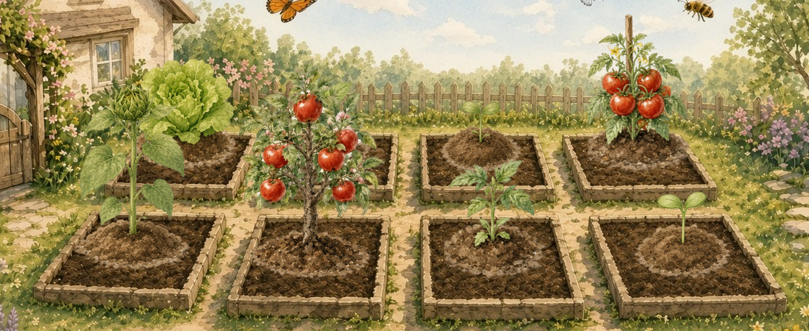
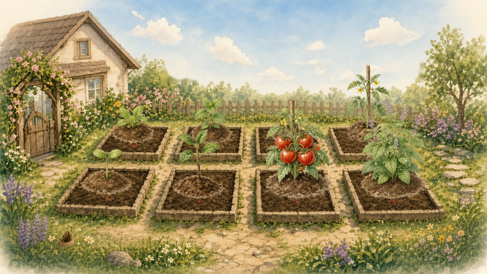

# Plant horizontal anchor (`anchorX`)

Bed centres in `ART.plots[].x` match painted soil on the backdrop; many plant PNGs are **not** centred on the canvas, so sprites were drawn with `-w/2` and looked shifted (especially stages 2–4).

Each stage in `renderer/art.js` now includes **`anchorX`**: the horizontal centre of the soil mound in sprite pixels, measured by `scripts/compute-plant-anchor-x.py` (bottom soil band + stem column). The renderer draws with **`-anchorX`** at the soil anchor and uses the same horizontal point for harvest/ready strips and tend FX.





Re-run after art changes:

```bash
python3 scripts/compute-plant-anchor-x.py
```