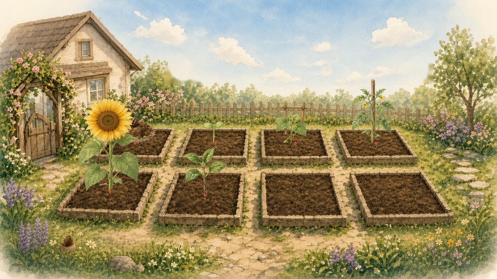

# Plant centering (mound-free sprites)

Heily repainted plant stages **2–5** and **picked** without the painted soil mound / pale rim (stage **1** still shows the seed mound). Sprites are **recentered on the canvas**; the renderer anchors at **`-w/2`** on the plot soil point (no per-stage `anchorX`).

## Metadata

- `assets/plants/plant-meta.json` is the source of truth for `base` (stem foot y) and `top` per stage.
- Sync into `renderer/art.js`: `node scripts/sync-plants-art-from-meta.js`
- Handoff zip (sprites + meta): `./scripts/apply-plants-handoff.sh /path/to/plants-centered.zip`

## Plot anchors

`ART.plots[].x/y` are soil centroids on the 1280×720 backdrop (day midday measure): back row **y ≈ 369**, front row **y ≈ 494–506**. Selection rings stay on painted bed offsets; plants use plot anchors.

## Before / after

Handoff: `./scripts/apply-plants-handoff.sh /path/to/plants-nomound.zip`